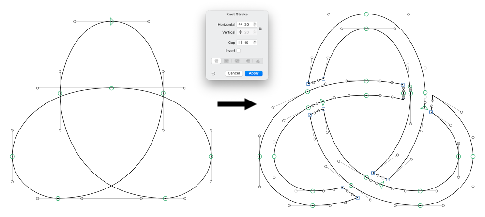

# Knot Stroke

A [Glyphs 3](https://glyphsapp.com) filter that turns centerline paths into a woven knot: it strokes the
paths like Offset Curve (separate horizontal and vertical width) and, at every crossing, cuts the
under-strand so strands pass alternately over and under.

## Install

Requires Glyphs 3 with the Python and skia-pathops modules (step 1 below). Developed and tested on macOS.

1. In Glyphs: Settings > Addons > Modules, install **Python**, then **skia-pathops** (used for the boolean operations).
2. Copy `KnotStroke.glyphsFilter` into `~/Library/Application Support/Glyphs 3/Plugins/`
   (or run `./install.sh` to link it), and restart Glyphs.

## Use

Draw the centerline (open or closed paths, self-crossing or several paths), then
Filter > Knot Stroke. With some paths selected (any of their nodes), only those are knotted and the rest of the
glyph is left alone; with nothing selected, all paths are.

In every number field (Horizontal, Vertical, Gap) the up/down arrow keys add/subtract 1 (10 with Shift),
and the stepper inside the field adds/subtracts 1 per click.

| Setting | Key | Values | Meaning |
| --- | --- | --- | --- |
| Horizontal | `horizontal` | number, above 0 | Stroke width in the horizontal direction, as in Offset Curve |
| Vertical | `vertical` | number, above 0 | Stroke width in the vertical direction |
| Lock icon | | | While locked, Vertical is grayed out and follows Horizontal. Not a custom parameter key |
| Ends | `cap` | 0 to 4 | How open paths end: the button position from the left, the same 5 as in Offset Curve. Grayed out when every path is closed |
| Gap | `gap` | number, 0 or more | Space kept clear on each side of the over-strand |
| Invert | `flip` | 0 or 1 | 1 swaps which strand starts on top |

It can also be used as a custom parameter on export, with the keys above:
`Filter = KnotStroke; horizontal:40; vertical:40; gap:14; flip:0; cap:0`.

## Uninstall

Quit Glyphs, delete `KnotStroke.glyphsFilter` (or the link `./install.sh` made) from
`~/Library/Application Support/Glyphs 3/Plugins/`, and restart Glyphs.

## Limits

Only straight and cubic segments are supported (no quadratic TrueType curves). A third strand running
through the gap of another crossing may get nicked. Tangential touches are not treated as crossings.

## Development

Geometry (crossings, over/under) lives in `knot.py` and is tested without Glyphs:
`python3 -I -m unittest discover -s tests`.

## License

MIT, © 2026 [Adrián Jiménez Pascual](https://dirdam.github.io). The `Contents/MacOS/plugin` loader comes from the
[GlyphsSDK](https://github.com/schriftgestalt/GlyphsSDK) (Apache 2.0).
